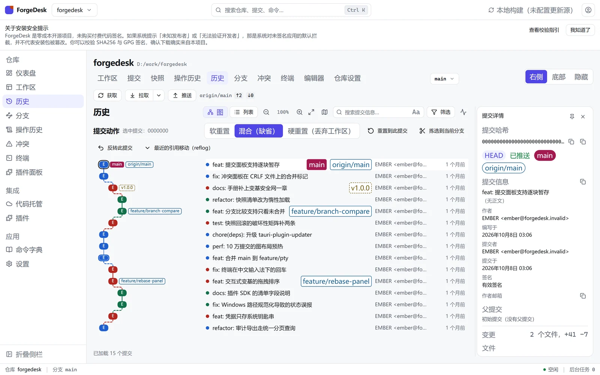

# ForgeDesk

**ForgeDesk — A Git client**（可写作 **ForgeDesk for Git**）

一个开源、跨平台、可自由分发的 Git 图形化桌面工作台：把复杂的 Git 与 GitHub 终端操作
变成可视化界面、向导与可交互图表。

[](https://github.com/Ember1414/forgedesk/actions/workflows/ci.yml)


> **项目状态**：**M0–M7 已验收完成；M8（最后一个里程碑）的工程交付已全部完成**——
> 发布渠道清单、文档与社区材料就绪，剩余为需要人类账号/真机执行的事项
> （逐条清单见 [`docs/acceptance/M8.md`](docs/acceptance/M8.md) §4）。
> 线上最新版本 **v1.1.3**（2026-10-09）：[下载页](https://forgedesk.pages.dev/download)
> 与 [Releases](https://github.com/Ember1414/forgedesk/releases) 提供
> **Windows**（NSIS / MSI / 便携版 zip）与 **macOS universal**（dmg，Apple Silicon 与 Intel 共用一个包）
> 产物，附 `SHA256SUMS` 与 GPG 签名；包管理器渠道（Scoop / Winget / Homebrew）清单见
> [`packaging/`](packaging/README.md)。Linux 暂缓（AppImage/deb/rpm 三套打包链与真机验证未完成），
> 见 [`docs/adr/ADR-005`](docs/adr/ADR-005-defer-cross-platform-verification.md)。
> 里程碑计划与验收见 [`docs/PLAN.md`](docs/PLAN.md) 与 [`docs/acceptance/`](docs/acceptance/M8.md)，
> 逐版本变更见 [`CHANGELOG.md`](CHANGELOG.md)。

---

## 一句话价值

Git 的命令行能力很强，但**理解**成本很高：为什么这个提交不见了？这次 `rebase` 到底改了什么？

ForgeDesk 的重点不是把命令排成按钮，而是**把 Git 的内部状态变成可看、可推演、可回滚的东西**：

- **可推演**：破坏性操作先给计划预览与等价命令，再执行；
- **可回滚**：写操作前自动快照，失败可一键还原；
- **可理解**：冲突、rebase、历史以图形与向导呈现，而不是一堆报错文本。

技术栈：**Tauri 2 + Rust**（后端）· **React + TypeScript + Vite + Tailwind**（前端）。
同一套源码构建三平台：Windows 与 macOS 已正式发布，Linux 打包按
[`ADR-005`](docs/adr/ADR-005-defer-cross-platform-verification.md) 暂缓。**零付费服务依赖**。

---

## 功能概览（当前版本 1.1.3）

| 领域          | 能力                                                                                                                                                                            |
| ------------- | ------------------------------------------------------------------------------------------------------------------------------------------------------------------------------- |
| 仓库与工作区  | 打开 / 克隆 / 初始化（目标目录不存在时自动创建）、最近仓库、状态分组（已暂存/未暂存/未跟踪）、树与平铺视图、批量操作、万行虚拟列表                                              |
| Diff 与暂存   | 统一 / 并排 diff、hunk 折叠、行级与块级暂存（结果与 `git diff --cached` 逐字节一致）                                                                                            |
| 提交          | 两段式提交（预览 + 等价 git 命令 + 索引指纹防串改）、amend、钩子清单与拒绝时可跳过重试、提交前自动快照                                                                          |
| 历史          | DAG 提交图（Canvas、分支泳道、命中检测、性能面板）、提交详情、筛选与搜索、迷你地图                                                                                              |
| 分支与同步    | 分支 / 标签管理、远端管理、fetch / pull / push（被拒走 `--force-with-lease`，**无裸 `--force`**）                                                                               |
| 高级操作      | stash、cherry-pick、revert、reset（含计划预览）、reflog 恢复                                                                                                                    |
| 冲突与 rebase | 三栏冲突解决向导（逐块采用/自定义）、拖拽式交互 rebase（reword/squash/fixup/drop/edit）                                                                                         |
| 安全网        | 操作快照 v2（含未跟踪文件备份）、一键回滚与回滚校验、操作历史时间线、破坏性操作安全测试矩阵                                                                                     |
| 代码托管      | OAuth Device Flow 与 PAT 登录、多账号、仓库面板、拉取请求审查与合并、议题、流水线日志、限流降级                                                                                 |
| 终端与编辑器  | 内嵌终端（xterm.js）、危险命令拦截、Git 命令解释词典（69 条命令）、错误诊断引擎、Monaco 编辑器（主题跟随应用、34 种语言高亮）、文件级历史与 blame、命令面板与自定义快捷键       |
| 扩展与外观    | 插件沙箱（wasmi + 权限白名单，**自带三个示例插件**、首次启动即装但初始禁用）、插件管理页与面板页、主题导入导出（4 套内置主题，含字体与动效维度）、中英双语、代理与 SSH/GPG 设置 |
| 发布与更新    | 自动更新（签名校验，**不提供跳过验签的路径**）、多平台打包（Windows NSIS/MSI/便携版 + macOS universal）、SHA256SUMS 与 GPG 签名                                                 |
| 工程底座      | 统一错误模型、SQLite + 版本化迁移、脱敏文件日志、i18n、明暗主题与 WCAG AA 对比度门禁、IPC 契约门禁（`pnpm check:ipc`）                                                          |

---

## 截图

| 工作区状态                             | 提交历史（DAG）                       |
| -------------------------------------- | ------------------------------------- |
|  |  |

更多界面见[官网](https://forgedesk.pages.dev/)（仪表盘、暗色历史等）；应用图标为 100% 原创设计
（[`docs/brand/`](docs/brand/icon-1024.png)）。

---

## 快速开始（从源码构建）

```bash
git clone https://github.com/Ember1414/forgedesk.git
cd forgedesk
pnpm install
pnpm dev              # 浏览器预览前端（含设计系统页 /#/__dev__/design）
pnpm tauri dev        # 完整桌面应用
pnpm tauri build      # 打包（本机平台；产物在仓库根的 target/release/bundle）
```

依赖与三平台差异见 [`docs/DEV-ENV.md`](docs/DEV-ENV.md)（含 Windows 工具链脚本、国内镜像、常见陷阱）。

---

## 安装

预编译版本从 **v1.0.0**（2026-10-08）起提供（**当前最新 v1.1.3**），两个入口都指向同一次发布：

- **下载页**：<https://forgedesk.pages.dev/download> —— 版本矩阵（平台 × 格式 × 大小 × SHA256）、
  三平台校验命令、GPG 验证与安装指引；版本信息取自发布清单，与应用内自动更新同源；
- **GitHub Releases**：全部历史版本、`SHA256SUMS` 与 `SHA256SUMS.asc`（GPG 分离签名）。

产物：Windows（NSIS `.exe` / MSI / **便携版 zip**）与 **macOS universal**（`.dmg`，Apple Silicon
与 Intel 共用一个包）。包管理器渠道清单已就绪（[`packaging/`](packaging/README.md)）：

- **Scoop**（`forgedesk`）：清单 + 本机安装实测完成，bucket 仓库上线后 `scoop install forgedesk` 即用；
  也可先从仓库内清单安装：`scoop install .\packaging\scoop\forgedesk.json`；
- **Winget**（`ForgeDesk.ForgeDesk`）/ **Homebrew Cask**（`forgedesk`）：草稿与提交流程齐备，
  待收录与真机验证（见 [`packaging/README.md`](packaging/README.md)）。

安装说明：[`docs/install/windows.md`](docs/install/windows.md)（产物命名、校验命令、SmartScreen 指引）、
[`docs/install/macos.md`](docs/install/macos.md)（去隔离、Gatekeeper 提示、校验）。

---

## 文档

| 文档                                                     | 内容                                               |
| -------------------------------------------------------- | -------------------------------------------------- |
| [`docs/PLAN.md`](docs/PLAN.md)                           | 项目计划书（范围、里程碑、验收标准）               |
| [`docs/acceptance/M8.md`](docs/acceptance/M8.md)         | M8 验收报告（逐条证据 + 剩余人类项）               |
| [`docs/M8-PLAN.md`](docs/M8-PLAN.md)                     | M8 计划（信任加固 / 分发 / 社区，按现状修订）      |
| [`docs/M7-PLAN.md`](docs/M7-PLAN.md)                     | M7 启动准备与进度记录（已完成）                    |
| [`docs/manual/README.md`](docs/manual/README.md)         | 用户手册（核心工作流）                             |
| [`docs/install/windows.md`](docs/install/windows.md)     | Windows 安装与校验（含 SmartScreen 指引）          |
| [`docs/install/macos.md`](docs/install/macos.md)         | macOS 安装与校验（去隔离、Gatekeeper 提示）        |
| [`docs/ARCHITECTURE.md`](docs/ARCHITECTURE.md)           | 分层架构与依赖规则                                 |
| [`docs/API.md`](docs/API.md)                             | 前后端 IPC 契约（命令与事件）                      |
| [`docs/CODING_STYLE.md`](docs/CODING_STYLE.md)           | 编码风格                                           |
| [`docs/PLUGIN-API.md`](docs/PLUGIN-API.md)               | 插件清单、权限与宿主 API                           |
| [`docs/DEV-ENV.md`](docs/DEV-ENV.md)                     | 开发环境与三平台差异                               |
| [`docs/FAQ.md`](docs/FAQ.md)                             | 常见问题                                           |
| [`docs/TROUBLESHOOTING.md`](docs/TROUBLESHOOTING.md)     | 故障排查                                           |
| [`docs/PRIVACY.md`](docs/PRIVACY.md)                     | 隐私政策与数据清单                                 |
| [`docs/RELEASE.md`](docs/RELEASE.md)                     | 发布流程（密钥、步骤、回滚）                       |
| [`docs/SIGNING.md`](docs/SIGNING.md)                     | 提交签名与验证                                     |
| [`packaging/README.md`](packaging/README.md)             | 包管理器分发清单（Scoop / Winget / Homebrew）      |
| [`docs/GOOD-FIRST-ISSUES.md`](docs/GOOD-FIRST-ISSUES.md) | 15 个新手任务（背景、步骤、验收、如何跑测试）      |
| [`docs/COMMUNITY.md`](docs/COMMUNITY.md)                 | 社区规范（渠道分工、响应 SLA、标签体系、回复模板） |

---

## 隐私

- **无 AI 功能**：应用不做任何模型推理，也不需要联网即可处理本地 Git 操作。
- **无遥测 SDK**：当前版本不收集、不上传任何使用数据。
- **凭据**：只存系统钥匙串（keyring），明文永不落盘；日志与错误详情在**写出前**统一脱敏。
- **日志**：本地文件，用户可随时打开目录查看或删除；绝不自动上传。

完整说明（数据清单、对外请求、用户权利）见 [`docs/PRIVACY.md`](docs/PRIVACY.md)。

---

## 参与

- **第一次参与？** [`docs/GOOD-FIRST-ISSUES.md`](docs/GOOD-FIRST-ISSUES.md) 有 15 个带完整引导的任务
  （背景、步骤、涉及文件、验收标准、如何跑测试）；
- 贡献方式、提交规范与 PR 流程：[`CONTRIBUTING.md`](CONTRIBUTING.md)
- 社区渠道、响应 SLA 与标签体系：[`docs/COMMUNITY.md`](docs/COMMUNITY.md)
- 行为准则：[`CODE_OF_CONDUCT.md`](CODE_OF_CONDUCT.md)
- 安全策略与漏洞报告：[`SECURITY.md`](SECURITY.md)
- 架构与分层规则：[`docs/ARCHITECTURE.md`](docs/ARCHITECTURE.md)
- 编码风格：[`docs/CODING_STYLE.md`](docs/CODING_STYLE.md)
- 前后端契约：[`docs/API.md`](docs/API.md)
- 代理/自动化约定（本仓库的工程红线与质量门禁）：[`AGENTS.md`](AGENTS.md)

本项目规模较大，**由人类维护者负责方向与审批、AI 编码代理负责执行**；
欢迎以 issue（Bug / 功能建议 / RFC / 插件问题）形式参与讨论。

---

## 许可证

[Apache License 2.0](LICENSE)。第三方依赖的许可证清单与合规策略见
[`docs/PLAN.md`](docs/PLAN.md) §9.4（`cargo-deny` 与许可证审计会在 CI 中强制执行）。

---

## Disclaimer / 免责声明

ForgeDesk is an independent, community-driven project. It is **not affiliated with,
endorsed by, or sponsored by** the Git project, the Software Freedom Conservancy,
GitHub, Inc., or the Tauri project.

- "Git" is a trademark of the Software Freedom Conservancy. ForgeDesk for Git is an
  independent Git client and is not produced or endorsed by the Git project.
- "GitHub" and the Octocat are trademarks of GitHub, Inc. ForgeDesk integrates with
  GitHub but is not affiliated with GitHub, Inc.
- "Tauri" is a project of the Tauri Programme within The Commons Conservancy.
  ForgeDesk is built with Tauri but is an independent project.

ForgeDesk contains **no AI features**. All code in this repository is developed with
AI-assisted tooling, but the shipped application performs no machine-learning
inference and works fully offline for local Git operations.
