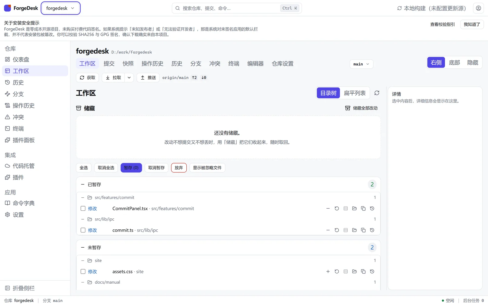

# ForgeDesk

**ForgeDesk — A Git client**

开源的 Git 与 GitHub 桌面工作台。查看提交图、审查文件差异、逐行暂存、解决冲突，
在同一个窗口里使用终端、编辑器和拉取请求审查。

[下载 Windows / macOS 版](https://forgedesk.pages.dev/download) ·
[用户手册](https://forgedesk.pages.dev/docs/) ·
[更新日志](CHANGELOG.md) ·
[问题反馈](https://github.com/Ember1414/forgedesk/issues)

[](https://github.com/Ember1414/forgedesk/actions/workflows/ci.yml)
[](LICENSE)


## 下载与安装

正式安装包以 [GitHub 最新 Release](https://github.com/Ember1414/forgedesk/releases/latest) 为准。
[官网下载页](https://forgedesk.pages.dev/download)提供平台选择、校验和与安装指引。

| 平台        | 下载格式                             | 要求与说明                                                                                    |
| ----------- | ------------------------------------ | --------------------------------------------------------------------------------------------- |
| Windows x64 | `.exe` 安装器、`.msi`、便携版 `.zip` | Windows 10 1809+，需要 WebView2；便携版解压后启动                                             |
| macOS       | universal `.dmg`                     | macOS 10.15+，Apple Silicon / Intel 共用安装包                                                |
| Linux       | 暂无官方安装包                       | 源码保留平台支持，打包与真机验收[暂缓](docs/adr/ADR-005-defer-cross-platform-verification.md) |

本机需安装 **Git** 并让它出现在 `PATH` 中。安装后可在终端运行 `git --version` 检查。
本地仓库操作不需要 GitHub 账号；访问私有仓库、同步远端或使用 GitHub 功能时再配置凭据。

安装包未购买商业代码签名，macOS 未做 Apple 公证，首次运行可能出现 SmartScreen / Gatekeeper 提示。
请先核对同次 Release 的 `SHA256SUMS`；GPG 签名与公钥的验证步骤见下载页及
[Windows 安装指南](docs/install/windows.md) / [macOS 安装指南](docs/install/macos.md)。
macOS 手动安装请下载 `.dmg`，`.app.tar.gz` 是应用自动更新包。

Scoop、Winget、Homebrew 的[分发清单](packaging/README.md)供维护和本地验证，
尚未全部完成官方渠道收录；不要把清单就绪理解为可直接从官方源安装。

## 第一次使用

1. 在首页打开已有仓库，或选择克隆 / 初始化。
2. 在“工作区”点选文件查看差异，按文件、块或行暂存修改。
3. 在“提交”填写说明，检查预览后执行；在“历史”查看提交图与详情。
4. 需要同步时配置远端与认证，再获取、拉取或推送。覆盖远端使用 `--force-with-lease`。

详细流程见[用户手册](docs/manual/README.md)。首次使用建议先在测试仓库熟悉快照与恢复操作。

## 能做什么

| 工作流       | 功能                                                                          |
| ------------ | ----------------------------------------------------------------------------- |
| 日常提交     | 状态分组、统一 / 并排 diff、行与块级暂存、提交预览、amend、Git hooks          |
| 历史与分支   | Canvas 提交图、筛选与搜索、提交详情、分支 / 标签 / 远端管理                   |
| 同步与整理   | fetch / pull / push、stash、cherry-pick、revert、reset、reflog、交互式 rebase |
| 冲突与恢复   | 三栏冲突编辑、逐块采用、操作快照、恢复校验、操作历史                          |
| GitHub       | OAuth Device Flow / PAT、多账号、仓库、PR 审查与合并、Issue、Actions 日志     |
| 终端与编辑器 | 内嵌终端、Monaco 多标签、文件历史与 blame、命令面板、自定义快捷键             |
| 外观与扩展   | 明暗主题、主题导入导出、中英双语、插件权限管理、代理与 SSH/GPG 设置           |
| 更新与分发   | 签名验证的自动更新、Windows 安装器与便携版、macOS universal 安装包            |



## 使用边界

- 快照是恢复手段，不能代替远端备份。大文件、未跟踪文件及外部工具操作的保护范围以
  [安全网手册](docs/manual/03-conflicts-rebase-safety-net.md)与界面提示为准。
- 内嵌终端执行的是系统命令，不能保证每条命令都有操作预览或可回滚快照。
- 编辑器草稿在当前进程内跨页面保留，尚不提供崩溃恢复；终端重开视图回放最近最多 1 MiB 输出。
- 全局跨仓库搜索尚未完成；提交搜索使用历史页，命令查找使用命令面板。
- [维护清单](docs/MAINTENANCE.md)记录尚未完成的性能、可访问性和平台验收事项。

## 隐私与安全

应用不含 AI / 机器学习推理功能，不接入第三方遥测或分析 SDK，不自动上传本地日志。
Git 远端、GitHub API、更新检查和连通性测试会按功能需要联网。

凭据优先存入系统凭据库，也支持用户解锁的本地加密保险库；不会因系统库不可用而静默写入明文文件。
使用方式见[账号与工具手册](docs/manual/04-github-and-tools.md)。日志与错误详情统一脱敏。
完整数据说明见[隐私政策](docs/PRIVACY.md)，漏洞报告请遵循[安全策略](SECURITY.md)。

## 从源码运行

技术栈：Tauri 2 + Rust，React + TypeScript + Vite + Tailwind。
需 Node.js、pnpm、Rust、Git 及对应平台的 Tauri 系统依赖，具体版本与安装步骤见
[开发环境](docs/DEV-ENV.md)。

```bash
git clone https://github.com/Ember1414/forgedesk.git
cd forgedesk
pnpm install --frozen-lockfile
pnpm tauri dev
```

`pnpm dev` 仅提供浏览器前端预览，文件系统和 Git 操作需要桌面宿主；
`pnpm tauri build` 构建本机安装包，产物位于 `target/release/bundle/`。

## 文档与贡献

- [文档索引](docs/README.md)：安装、手册、故障排查与开发资料。
- [贡献指南](CONTRIBUTING.md)：本地检查、提交规范与 PR 流程。
- [架构](docs/ARCHITECTURE.md) / [IPC API](docs/API.md) / [编码风格](docs/CODING_STYLE.md)。
- [发布流程](docs/RELEASE.md) / [依赖安全审计](docs/SECURITY-AUDIT.md) / [许可证清单](docs/LICENSE-AUDIT.md)。
- [社区说明](docs/COMMUNITY.md) / [入门任务](docs/GOOD-FIRST-ISSUES.md) / [行为准则](CODE_OF_CONDUCT.md)。

按 [Apache License 2.0](LICENSE) 开源，可自由使用、修改与分发。

## Disclaimer / 免责声明

ForgeDesk is an independent project. It is **not affiliated with, endorsed by, or sponsored by**
the Git project, the Software Freedom Conservancy, GitHub, Inc., or the Tauri project.

- Git is a trademark of the Software Freedom Conservancy.
- GitHub and the Octocat are trademarks of GitHub, Inc.
- Tauri is a project of the Tauri Programme within The Commons Conservancy.

The application contains **no AI features** and performs no machine-learning inference.
AI-assisted tools are used during development. Local Git operations work offline.
